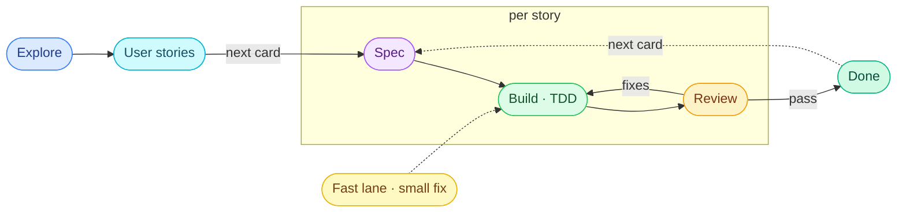
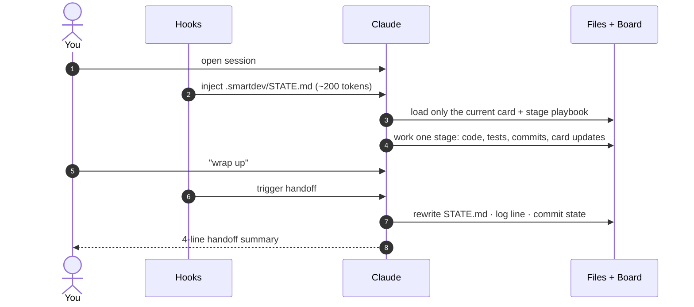
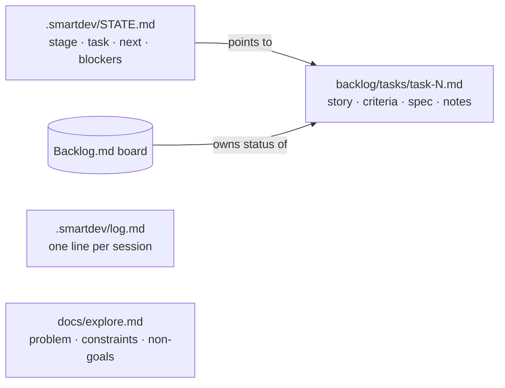

<p align="center"></p>

<p align="center">
  
  
  
  
</p>

**A Claude Code plugin that turns AI-assisted coding into a disciplined pipeline.** Every project moves through explore → stories → spec → test-first build → review, one stage per session. State lives in files and on a Kanban board, never in chat history.

| Without it | With smartdev |
|---|---|
| Long chats that drift, and quality drops as context fills | One stage per fresh session, kept under 40% context |
| Scope creeps mid-session | Every new idea becomes a **Parked** card, never code |
| "Where was I?" after a week away | State loads automatically when a session starts |
| AI says "done" without proof | Test-first build, then an independent review session |

## Pipeline



| | Stage | Output |
|:-:|---|---|
|  | **Explore** | `docs/explore.md`: problem, users, constraints, how to test |
|  | **Stories** | One board card per story, with acceptance criteria, plus non-goals |
|  | **Spec** | A minimal plan inside the card: approach, files, test list |
|  | **Build** | Red → green → refactor, one commit per green test |
|  | **Review** | Fresh eyes check code against spec and criteria. Pass → Done, fail → fix list |
|  | **Fast lane** | Small fixes skip straight to build and review |

## Quick start

```bash
git clone git@github.com:Suman196pokhrel/smartdev.git ~/DevStuff/projects/smartdev
~/DevStuff/projects/smartdev/install.sh
```

Restart Claude Code, open any project and run **`/smartdev:start`**.

<sub>Needs <code>git</code>, <code>jq</code>, <code>npm</code>, <code>claude</code> and a <a href="https://www.nerdfonts.com">Nerd Font</a> for the status line icons. Update with <code>git pull</code> then <code>/reload-plugins</code>.</sub>

## A session



## Commands

| | You do | What happens |
|:-:|---|---|
|  | `/smartdev:start` | Sets up a new project (git, board, state) or continues the current stage |
|  | `wrap up` | Updates the card, rewrites state, logs the session, commits |
|  | `backlog browser` | Kanban board in the browser (`backlog board` for the terminal) |
|  | `smartdev` | Every Smart Dev project on this machine: stage, task, progress, last session |

## Status line

Line 1 is always shown. Line 2 appears only inside Smart Dev projects.

| Segment | Why it's there |
|---|---|
| **Context bar** | Turns yellow at 30% and red at 40%, telling you when to hand off |
| **Last commit age** | Turns yellow when changes have sat uncommitted for 30+ minutes |
| **Git** | Branch, ahead/behind, staged, modified and untracked counts |
| **Usage** | Your 5-hour limit, with the reset time shown when it runs high |
| **Stage + task** | Where the pipeline is and which card is active |
| **Acceptance criteria** | Ticked criteria on the active card, e.g. `1/2` |
| **Board** | Stories done out of total, plus how many are parked |
| **Blocked** | Shown in red when the state has a blocker |

## Where state lives



<sub>Everything is plain Markdown in the repo, so it's tracked in git. The board owns task status; STATE.md owns the pipeline stage.</sub>

<details>
<summary><b>Repo layout</b></summary>

```
.claude-plugin/   plugin + marketplace manifests
skills/start/     rules, init.sh, STATE template, stages/*.md (only the current one is read)
skills/handoff/   session close
hooks/            inject state on start · catch "wrap up"
statusline.sh     two-line status line
status.sh         the `smartdev` command
install.sh        setup and update, safe to re-run
docs/             banner, icons (Lucide, ISC), Excalidraw overview
```
</details>
